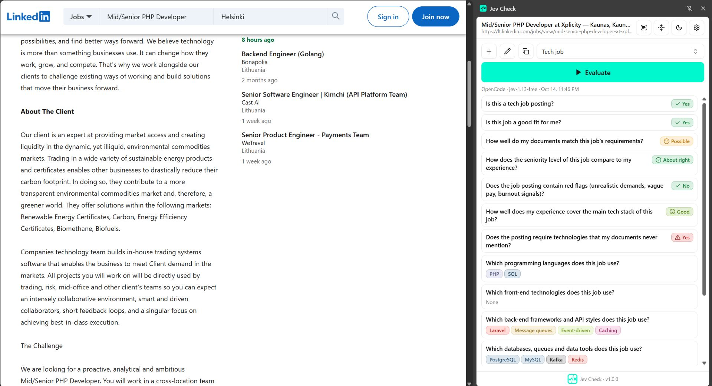

<div align="center">


# Jev Check

**Ask any web page the questions that matter, right from your browser's side panel.**

Pick a question set, click **Evaluate**, and get clear, probability-backed answers about the page you are reading: is this job a fit, is this article trustworthy, is this policy safe to accept.

[](LICENSE)


</div>

<p align="center">
  
</p>

<p align="center">
  <a href="https://chromewebstore.google.com/detail/acobeddijnaokjkpkmcdfoepbmibpicc?utm_source=item-share-cb"></a>
  &nbsp;
  <a href="https://addons.mozilla.org/en-US/firefox/addon/jev-check-ai-page-evaluator/"></a>
</p>

> **Jev Check is an independent project. It is not an official TypeSafe product.**

---

## What it does

Jev Check reads the page you are on, turns it into clean Markdown, and sends it together with *your* questions to a decision model through the provider you choose. Results come back as answers with probabilities, not walls of text.

- **Question sets**: yes/no, choice, score (2–10 ordered levels) and multi-pick questions, with ready-made answers, color palettes and icons. Add hidden *details for the model* to any question.
- **Ready-made templates**: start in seconds, then adapt them. Clone any set to make a variant.
- **Your own documents**: upload a resume, a budget or a checklist (DOCX, PDF, Markdown, TXT), review and edit it as Markdown, and have the page judged against it. Documents form one shared library that any set can use.
- **Spreadsheet answers**: import a long answer list (e.g. a list of technologies) from CSV, TSV or XLSX.
- **Follow-up logic**: show a question only when an earlier answer qualifies; hidden questions can still be revealed.
- **Saved results**: identical inputs (same page, set, documents and model) reuse the earlier result, with a per-page history you can browse and prune.
- **Selection support**: right-click selected text to evaluate just that part.
- **Quick access**: mark a set as *quick access* and it appears in the right-click menu. Picking it opens the panel and runs the set on the selection.
- **One panel per tab**: each tab keeps its own panel, page and results, and follows the tab as it navigates.
- **Clean reading view**: inspect exactly what the model reads, as raw or rendered Markdown.
- **Compact view and dark mode**: show only the winning answer of each question; light and dark themes.

## How to use it

1. Click the Jev Check toolbar icon. On first run, accept the notice, pick a template (and upload the documents it needs), then add an API key.
2. Choose a question set and press **Evaluate**.
3. Each question shows its answers ranked by probability, the winner highlighted in its color. Multi-pick questions highlight every answer at or above the question's threshold.
4. Use **+** to start a set from a template or from scratch, the pencil to edit it, and the copy button to clone it. Drag questions to reorder them (collapse them first).

Limits follow the Jev model: about 32k tokens for the context, documents and page together (plus the longest question), 64k per request, up to 50 questions and 255 answers per choice. The editor shows a live token budget and blocks sets that don't fit. When a page is too long, its middle is left out (the top 70% and bottom 30% of what fits are kept) and the result says so.

## Templates

| Template | Answers |
| --- | --- |
| Article credibility | Is this article trustworthy? Sourcing, bias, supported claims. |
| Job fit | Does this posting suit you, based on your resume? |
| Tech job | Job fit for software roles, plus the stack the posting uses. |
| Product / shopping | Is it worth buying? Price, reviews, hidden costs. |
| Travel booking | Hotel, flight or tour: fit, value, fees, cancellation terms. |
| Rental / real estate | Does the listing fit your budget and must-haves? |
| Terms & privacy | Is this policy safe to accept? Flags data sharing and unfair terms. |
| SEO content checkup | Topic focus, search intent, depth and trust signals of the written content. |

## Privacy

Jev Check is **completely bring-your-own-key**.

- No server, no accounts, no analytics, no tracking. **We collect no data.**
- Question sets, documents and results live in your browser (IndexedDB).
- API keys are encrypted (AES-GCM) in `chrome.storage.local`; the encryption key is non-extractable.
- When you press Evaluate, the page text, your question set, its context and your documents are sent to **the provider you selected, and only to it**. Their privacy policy and terms apply, and the first-run notice asks you to accept them.
- Privacy: see [PRIVACY.md](PRIVACY.md).
- Permissions are minimal: the toolbar click grants `activeTab`, and each provider's host is an *optional* permission requested only when you add a key.

| Permission | Why |
| --- | --- |
| `activeTab`, `scripting` | Read the page you opened the panel on, only after you click the icon or the menu entry |
| `tabs` | Follow the panel's own tab as it navigates |
| `sidePanel` | Show the panel |
| `contextMenus` | The right-click entry and quick-access sets |
| `storage`, `unlimitedStorage` | Keep sets, documents, results and encrypted keys locally |
| Optional hosts | Reach your provider; or read a site when the panel was not opened from the toolbar there (asked per site) |

Browser pages (`chrome://`, `about:`), the Chrome Web Store, addons.mozilla.org and PDFs viewed in the browser can't be read.

> Jev Check only sees the page's **readable text**. Images, layout, page speed, HTML structure and source code are stripped, so it can't judge them. Templates are written with that in mind.

## Supported providers

| Provider | Notes |
| --- | --- |
| Vercel AI Gateway | |
| OpenRouter | |
| OpenAI | |
| TypeSafe | |
| OpenCode | Free model available |
| Custom | Any OpenAI- or TypeSafe-compatible endpoint |

## Getting started

Requirements: [Node.js](https://nodejs.org) 20+, [pnpm](https://pnpm.io) and Chrome (or another Chromium browser) 114+, or Firefox 140+.

```bash
git clone https://github.com/amir9480/JevCheck.git
cd JevCheck
pnpm install
pnpm dev                 # Vite dev server; load build unpacked
```

Build and load it yourself:

```bash
pnpm build:chrome        # outputs to build
```

Then open `chrome://extensions`, enable **Developer mode**, choose **Load unpacked** and select `build`. Click the toolbar icon on any page to open the side panel.

For Firefox, run `pnpm build:firefox` (outputs to `build-firefox`), open `about:debugging#/runtime/this-firefox`, choose **Load Temporary Add-on** and pick `build-firefox/manifest.json`. Clicking the toolbar icon opens the sidebar; it follows the active tab.

| Command | Purpose |
| --- | --- |
| `pnpm dev` | Dev mode with HMR (crxjs) |
| `pnpm dev:chrome` | Dev mode plus a Chromium window with the extension loaded |
| `pnpm dev:google-chrome` | Same, preferring Google Chrome |
| `pnpm build` | Typecheck and production build |
| `pnpm build:chrome` | Production build without typecheck |
| `pnpm package` | Typecheck, build and zip to `release/` for the Web Store |
| `pnpm dev:firefox` | Rebuild on change and run Firefox with the add-on loaded (auto-reloads; no HMR). `-- --firefox=deved` picks another Firefox |
| `pnpm build:firefox` | Firefox production build to `build-firefox` |
| `pnpm package:firefox` | Typecheck, build and zip to `release/` for addons.mozilla.org |
| `pnpm lint:firefox` | Validate `build-firefox` with `web-ext lint` |
| `pnpm exec tsc --noEmit` | Typecheck |

## Tech stack

[Vite](https://vite.dev) + [CRXJS](https://crxjs.dev) · TypeScript · React 18 · Tailwind CSS v4 · shadcn/ui · Dexie (IndexedDB) · Turndown · Milkdown · pdf.js · Mammoth · pnpm

## Project structure

```
src/
├── background.ts        # side panel and context menu wiring
├── sidebar/             # the side panel app
├── components/          # UI (question sets, editor, evaluation, dialogs)
├── lib/
│   ├── extract-page.ts  # reads the panel's tab
│   ├── visible-html.ts  # collects only what is visibly rendered (or selected)
│   ├── clean-html.ts    # strips noise before conversion
│   ├── convert/         # document uploads → Markdown
│   ├── decision/        # provider clients and limits
│   ├── evaluate-set.ts  # builds the request, caches results
│   ├── dependencies.ts  # follow-up question rules
│   └── key-vault.ts     # encrypted API key storage
└── templates/           # ready-made question sets
```

## Contributing

Contributions are welcome at [github.com/amir9480/JevCheck](https://github.com/amir9480/JevCheck). Report bugs or ideas in [Issues](https://github.com/amir9480/JevCheck/issues). Fork the repo, make your change on a branch and open a pull request. For bigger changes, open an issue first so we can agree on the direction.

Adding a template is a good first contribution: create `src/templates/<name>/index.ts` that exports a `QuestionSetTemplate`, and list it in `src/templates/index.ts`. Keep questions about what the page's *wording* says.

## License

Jev Check is free software under the **[GNU General Public License v3.0](LICENSE)**. You may use, study, change and share it, but any distributed version, modified or not, must stay under the GPL with its source available and keep its copyright notices.

The name "Jev Check" and its logo identify this project. Please choose a different name and icon for your own fork. Jev Check is not affiliated with TypeSafe or any provider listed above.

Jev Check is provided "as is", without warranty. Results come from AI models and can be wrong; they are not professional, legal or financial advice.
